# DebuggerTest – SimpleCalc Android App

An Android calculator developed in **Java** using **Android Studio**. It supports four arithmetic operations and demonstrates how to inspect and troubleshoot application code with the Android Studio **Debugger**.

## 📱 Overview

SimpleCalc takes two numbers and displays the result of the selected operation. The application also handles missing or invalid input and shows Java's special floating-point results, such as `Infinity` and `NaN`.

## ✨ Features

- **Addition (ADD)** – Adds two numbers.
- **Subtraction (SUB)** – Subtracts the second number from the first.
- **Division (DIV)** – Divides the first number by the second.
- **Multiplication (MUL)** – Multiplies two numbers.
- **Decimal Support** – Accepts decimal input with either `.` or `,`.
- **Input Validation** – Catches invalid input instead of crashing.
- **Debugging Tools** – Uses breakpoints, step controls, Frames, Variables, Watches, Evaluate Expression, and Logcat.

## 🛠️ Technologies Used

- **Java** – Calculator logic and input validation.
- **XML** – Application layout and string resources.
- **Android Studio** – Development and debugging.
- **Android SDK** – Application framework and emulator.
- **Gradle** – Build system.

## ⚙️ Implementation

| Component | Purpose |
|---|---|
| `MainActivity.java` | Button clicks, input reading, `compute()`, results, and error handling. |
| `Calculator.java` | Static methods for ADD, SUB, DIV, and MUL. |
| `activity_main.xml` | Two number inputs, four buttons, and a result display. |
| `strings.xml` | Text displayed in the application. |
| `Double.parseDouble()` | Converts the input text to `double`. |
| `try/catch` | Handles `NumberFormatException`. |
| `Logcat` | Shows messages and exception stack traces. |

### How It Works

1. The user enters two numbers and presses **ADD**, **SUB**, **DIV**, or **MUL**.
2. `MainActivity` calls `compute()` with the selected operator.
3. `getOperandText()` reads each field, and `getOperand()` converts it using `Double.parseDouble()`.
4. `compute()` calls the corresponding method in `Calculator`.
5. The result is displayed in a `TextView`. Invalid input is caught and reported.

For example, division is implemented using the `double` type:

```java
public static double divide(double operandOne, double operandTwo) {
    return operandOne / operandTwo;
}
```

## 🐞 Debugging

The screenshots below were taken while testing the app in Android Studio using a **Pixel 9 emulator**. Each image is resized to **50% of its original width and height**.

### 1. Breakpoints, Frames, and Variables

A breakpoint in `compute()` pauses execution before the first operand is read. The debugger shows the **Frames** call stack, the current thread, and `operator = ADD`.

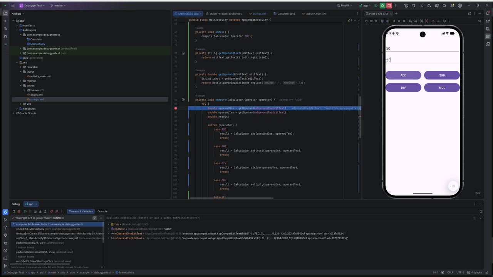

### 2. Step Over, Step Into, Step Out, and Resume

- **Step Over (`F8`)** runs the current line without opening a called method.
- **Step Into (`F7`)** enters a called method such as `getOperand()` or `Calculator.divide()`.
- **Step Out (`Shift + F8`)** returns to the calling method.
- **Resume (`F9`)** continues execution until the next breakpoint.

The screenshot shows the debugger inside `Calculator.divide()` with the operands visible in **Variables** and the calling methods in **Frames**.


### 3. Conditional Breakpoints

A conditional breakpoint was placed on `switch (operator)`:

```java
(operandOne == 42) || (operandTwo == 42)
```

The debugger pauses if **either operand is 42**.

| Input | Breakpoint triggered? |
|---|---|
| `12`, `7` | No |
| `42`, `7` | Yes |
| `7`, `42` | Yes |
| `7`, `8` | No |

A breakpoint can also be individually disabled or temporarily ignored with **Mute Breakpoints**.

**Breakpoint condition:**

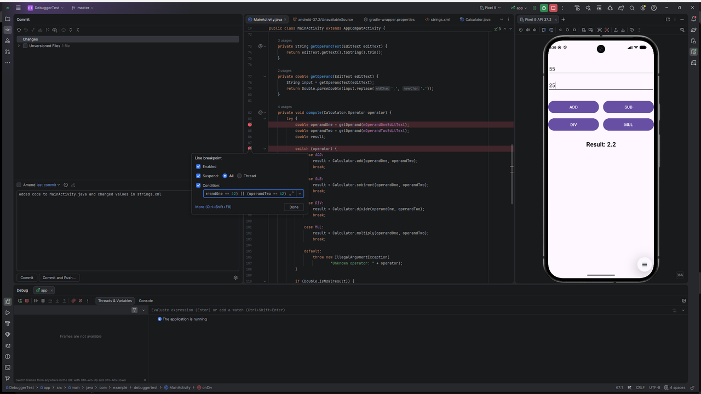

**First operand equals 42:**

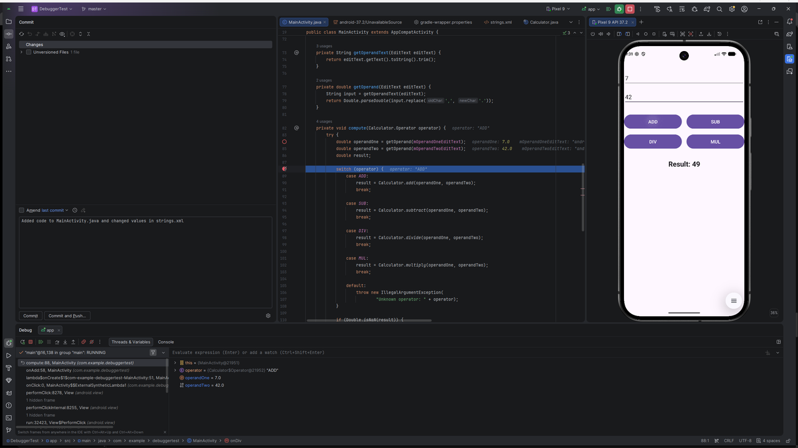

**Second operand equals 42:**

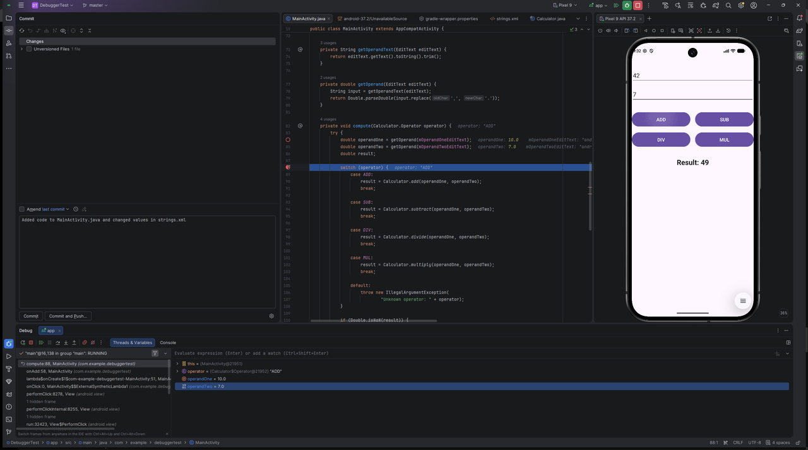

### 4. Set Value, Watches, and Evaluate Expression

**Set Value** changes variables during debugging without changing the numbers shown in the input fields.

| Operation | Input fields | Debugger values | Final result |
|---|---|---|---|
| ADD | `42`, `7` | `10`, `10` | `20` |
| MUL | `42`, `7` | `3`, `3` | `9` |

**ADD – variables changed to 10 and 10:**


**ADD – result 20:**

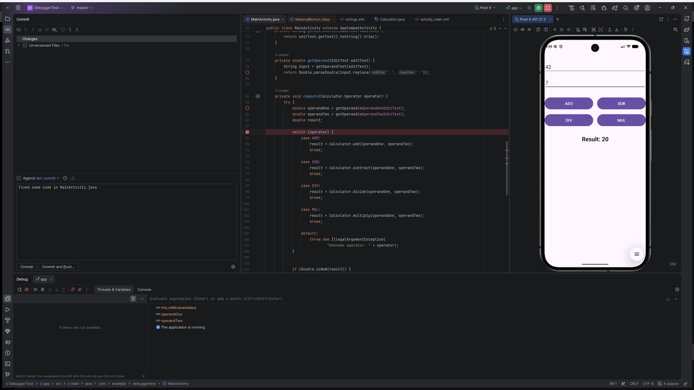

**MUL – variables changed to 3 and 3:**

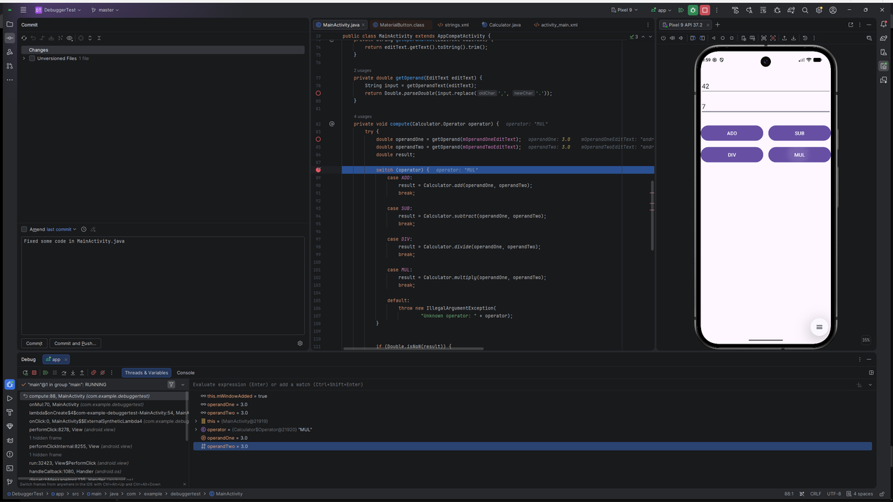

**MUL – result 9:**


**Watches** keep selected expressions visible while execution is paused. In the screenshot, the expression `operandOne + operandTwo` evaluates to `49.0` when the values are `42.0` and `7.0`.

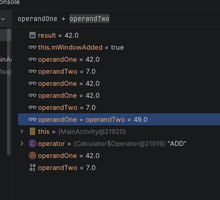

**Evaluate Expression** allows expressions to be checked without changing the source code:

| Expression | Result with 42 and 7 |
|---|---|
| `operandOne + operandTwo` | `49.0` |
| `operandOne * operandTwo` | `294.0` |
| `operandOne == 42` | `true` |
| `mOperandOneEditText.getHint()` | `First number` |
| `mOperandOneEditText.getText().toString()` | `42` |

**Multiplication expression:**

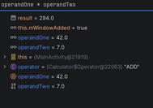

**Reading the input hint:**

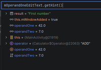

### 5. Invalid Input and Logcat

An empty input causes `Double.parseDouble("")` to throw a **`NumberFormatException`**. The debugger can pause inside `getOperand()` to inspect the empty string. The `catch` block in `compute()` handles the exception so the application can show an error instead of crashing.

**Empty first input before conversion:**

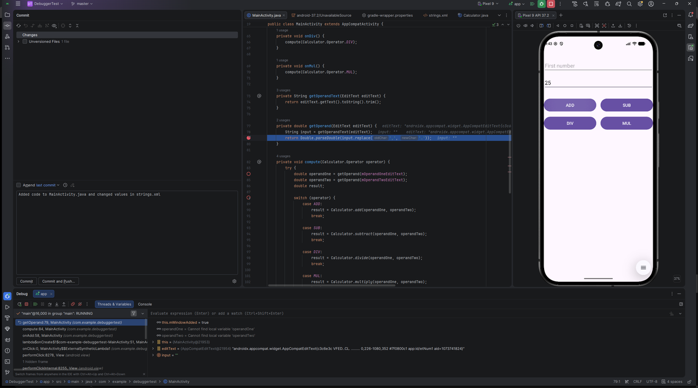

**Logcat stack trace (`tag:SimpleCalc`):**

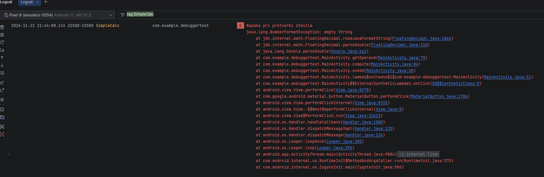

### 6. Division by Zero

Java's floating-point division behaves differently from integer division:

| Calculation | Result |
|---|---|
| `55.0 / 0.0` | `Infinity` |
| `0.0 / 0.0` | `NaN` |
| `55.0 / 25.0` | `2.2` |

**55 ÷ 0 → Infinity:**

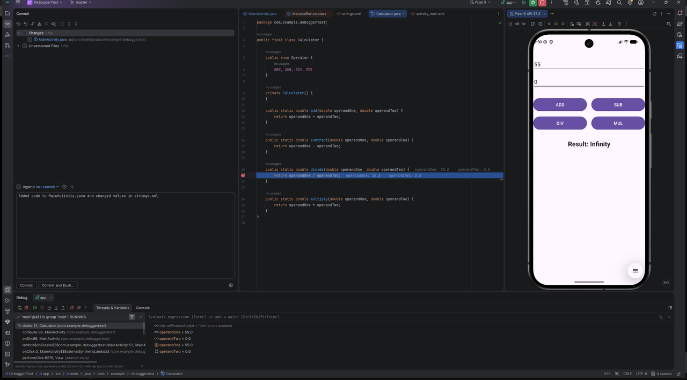

**0 ÷ 0 → NaN:**

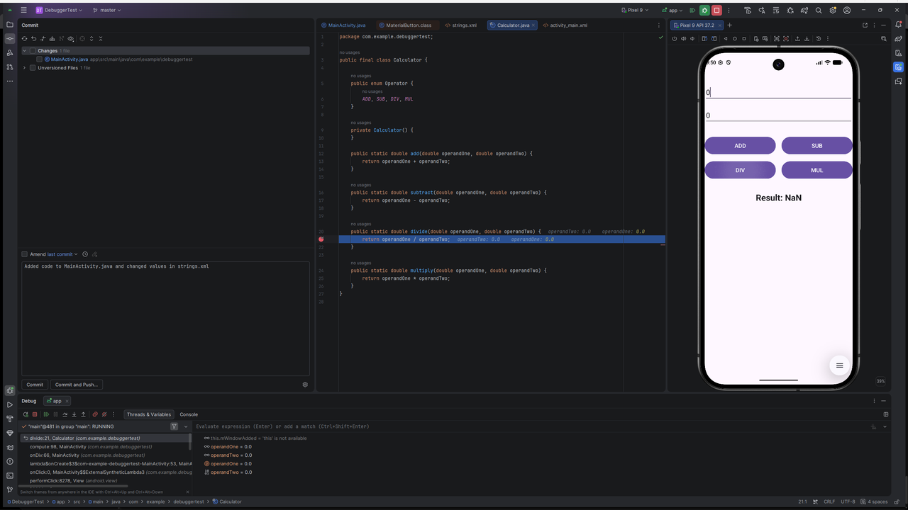

**1.6753456 / 0.1**


## 🧪 Example Calculations

| Number 1 | Number 2 | Operation | Expected result |
|---:|---:|---|---:|
| 55 | 25 | ADD | 80 |
| 55 | 25 | SUB | 30 |
| 55 | 25 | DIV | 2.2 |
| 55 | 25 | MUL | 1375 |
| 55 | 0 | DIV | Infinity |
| 0 | 0 | DIV | NaN |

## 🚀 Getting Started

1. Download or clone this repository.
2. Open the project in **Android Studio**.
3. Wait for **Gradle Sync** to finish.
4. Select an Android emulator or a connected physical device.
5. Click **Run** to use the calculator or **Debug** to inspect its execution.

## 📂 Project Structure

```text
DebuggerTest/
├── app/src/main/
│   ├── java/com/example/debuggertest/
│   │   ├── MainActivity.java
│   │   └── Calculator.java
│   ├── res/layout/activity_main.xml
│   └── res/values/strings.xml
├── screenshots/
│   ├── 01-standard-breakpoint.png
│   ├── 02-step-into-calculator.png
│   └── ...
└── README.md
```

## 🎯 Purpose

The project demonstrates how the **Android Studio Debugger** can be used to follow method calls, inspect and modify variables, evaluate expressions, diagnose exceptions, and verify calculations in an Android application.

## 👤 Author

**Tristan Čebron**  
GitHub: [@TristanCebron](https://github.com/TristanCebron)
